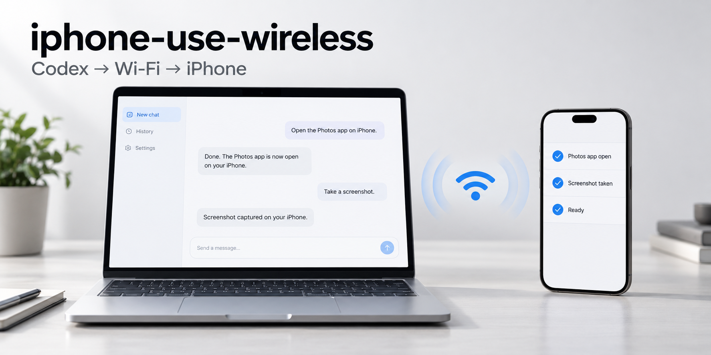

# iphone-use-wireless

**Use Wi-Fi to let Codex get things done on your iPhone.**

Ask Codex to open apps, find information, enter text, tap, and swipe. After initial USB pairing, signing, and tunnel setup, unplug the cable and use your iPhone wirelessly on the same network as your Mac.

[中文](README.md) · [Setup guide](docs/WIRELESS_SETUP.en.md)



<sub>Wireless control concept illustration</sub>

## What you can do

- **Operate over local Wi-Fi**: after initial pairing and setup, connect through your Mac and unplug the data cable for everyday use.
- **Read the screen**: inspect text and UI controls first, use screenshots when needed, then tap, type, or swipe.
- **Open and switch apps**: open apps on your phone, move between them, or return to the Home Screen.
- **Search and summarize**: search inside apps, open details, and turn information visible on the current page into a list or summary.
- **Fill in and write**: use the text you provide to complete forms, write lists in Notes, or draft text in an input field.
- **Handle continuous tasks**: work through multiple pages, switch apps when needed, and check the result after each step.

## Get started

Bring a Mac, an iPhone running iOS 18+, a cable for initial pairing, and your own Apple Account. Send the repository link and the prompt below to **Codex running on your Mac**. It can check the environment, help prepare software including Xcode, and guide setup.

```text
Help me set up iphone-use-wireless to control my own iPhone over Wi-Fi.
Repository: https://github.com/xxwzkdwz/iphone-use-wireless

Follow the guide: check the environment, help prepare missing software, and run setup.sh.
Then pair the phone, configure WDA, and prepare the wireless tunnel.
Reuse existing configuration. Guide me when I need to sign in to Apple,
plug or unplug USB, trust the Mac, enable Developer Mode, or enter a password locally.
Finish by connecting and reading the screen with USB unplugged.
```

Codex can run checks, installation, and configuration commands. You handle Apple sign-in, phone trust and Developer Mode confirmations, and any required passwords locally. Full Xcode is required to run the project and can be prepared during setup. Follow the [installation guide](docs/WIRELESS_SETUP.en.md).

<details>
<summary>Manual installation</summary>

Run these commands in a local terminal:

```sh
git clone https://github.com/xxwzkdwz/iphone-use-wireless.git
cd iphone-use-wireless
bash scripts/setup.sh --check
bash scripts/setup.sh
```

`--check` reports readiness. Resolve missing system software first; if only plugin dependencies are missing, run `setup.sh` to install them. Installation requires full Xcode, uv (which prepares Python 3.11+), Node.js 22.12+ (22.x) or 24+, npm 10+, and the Codex CLI. `setup.sh` installs plugin runtime dependencies and registers the plugin, preserving device configuration without connecting the phone.

Continue with signing, configuration, and the tunnel in the [guide](docs/WIRELESS_SETUP.en.md). Open a new chat and run `setup` to check the actual installed copy. The internal installation identifier remains `iphone-use`.

Other MCP clients can launch this project's `scripts/run-server.sh` with `bash`. For direct registration in the Codex CLI:

```sh
codex mcp add iphone_use -- bash '/absolute/path/to/iphone-use-wireless/scripts/run-server.sh'
```

Choose either plugin installation or direct MCP registration; use `bash scripts/setup.sh --skip-plugin` to prepare dependencies without registering the plugin.

</details>

## Try a task

> Connect to my phone with iphone-use-wireless and tell me which screen is open.

> Search for nearby coffee shops in Maps, make a list of three places shown on the screen, and write it in Notes.

> Fill in the current form using the information I provide, and stop before submitting so I can review it.

Keep the Mac awake, the phone unlocked on the same reachable network, and the foreground wireless tunnel running. Then give Codex a task; ask it to disconnect the phone session when finished.

## More

[Setup and troubleshooting](docs/WIRELESS_SETUP.en.md) · [Changelog](CHANGELOG.md) · [MIT License](LICENSE) · [Third-party notices](THIRD_PARTY_NOTICES.md)
